<h1>
  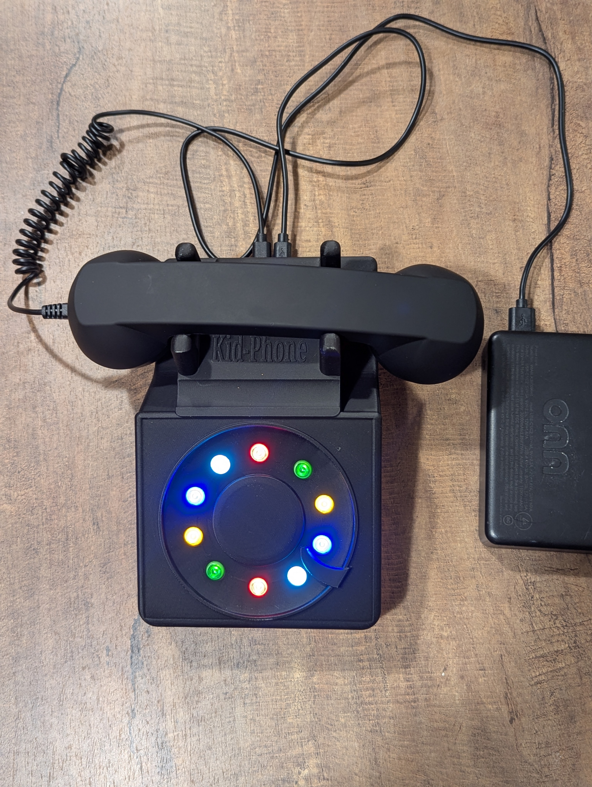
  Retro Rotary Kid Phone
</h1>
<br>


These are my notes:

This is a retro-inspired phone case built for the open-source Kid-Phone firmware project which is designed around an ESP32-S3 and Twilio phone service. 
This repository contains the custom 3D printable enclosure, wiring references, assembly photos, and a few build notes used to create a fully functional WiFi Kid-Phone enclosure.
This is my second version, and it has a rotary phone look with 10 configurable speed dial led buttons.

---

## Overview

While searching for WIFI phones for the grandkids that would use a microcontroller, <br>
I discovered this interesting ESP32 projects by Allan Binder. <br>
The concept is excellent, but I wanted a more retro-inspired enclosure that looked like a classic desktop telephone for the grandkids.

This project combines the original Kid-Phone software, which is an amazing project, and my custom-designed 3D printed enclosure with the illuminated arcade-style pushbuttons.

### Original Project Resources

**Project Article**
https://muonsortes.com/toddler-phone#using <br>
**GitHub Repository**
https://github.com/AllanBinder/kid-phone <br>
**Web Installer**
https://allanbinder.github.io/kid-phone/ <br>

---

## Features
- Retro telephone inspired enclosure that is fully 3D printable
- Kid-phone:
	- ESP32-S3 based design
	- 10 illuminated pushbuttons
	- Easy firmware installation using the official web installer
	- Local web-based configuration interface


---

## Repository Contents

```text
.
├── 3d
│   ├── retaryPhoneKid-phone-Bottom.stl
│   ├── retaryPhoneKid-phone-SPI32Cover.stl
│   ├── rotary-kid-phone-buttonTray.stl
│   ├── rotary-kid-phone.3mf
│   ├── rotary-kid-phone.stl
└── images
```

### Included Files

| File | Description |
|--------|-------------|
| retaryPhoneKid-phone-Bottom.stl | Phone bottom housing |
| retaryPhoneKid-phone-SPI32Cover.stl | ESP32-S3 cover |
| rotary-kid-phone-buttonTray.stl | Button holder tray |
| rotary-kid-phone.stl | Phone top housing |
| rotary-kid-phone.stl | All components arranged for printing |
<br>
The included 3MF file contains all parts pre-positioned for printing.
<br>

---

# Design Gallery

## Front View
These are pictures of the Phone when assembled and running with the buttons illuminated

| Printed Assembly |
|--------|-------------|
|  | 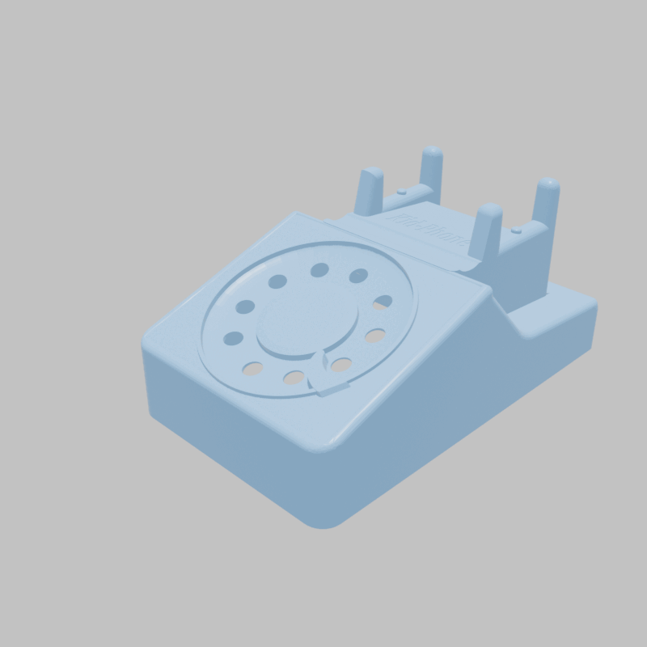 |
<br>

---


## Bottom View
The ESP32 status lights are viewable through the bottom plate.
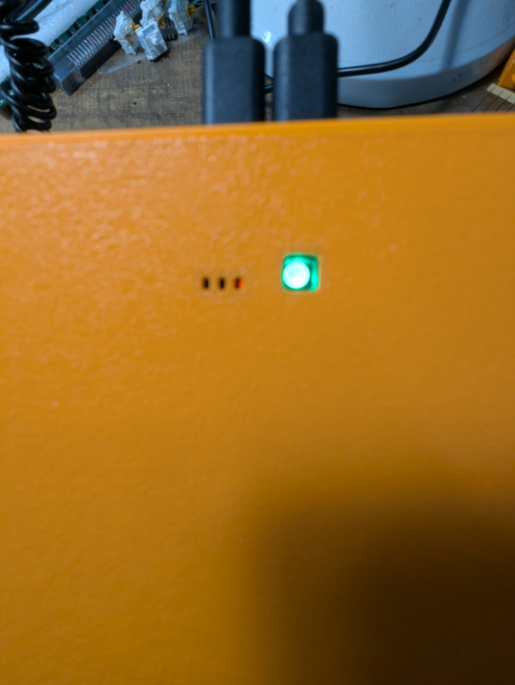
<br>

---

## Illuminated Pushbuttons

Purchase Link: https://www.amazon.com/dp/B0F47MJNJY

| Product Listing | Installed In the button tray |
|----------------|---------------------|
| 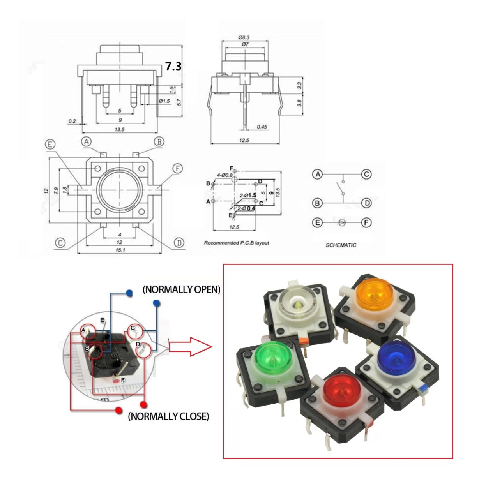 | 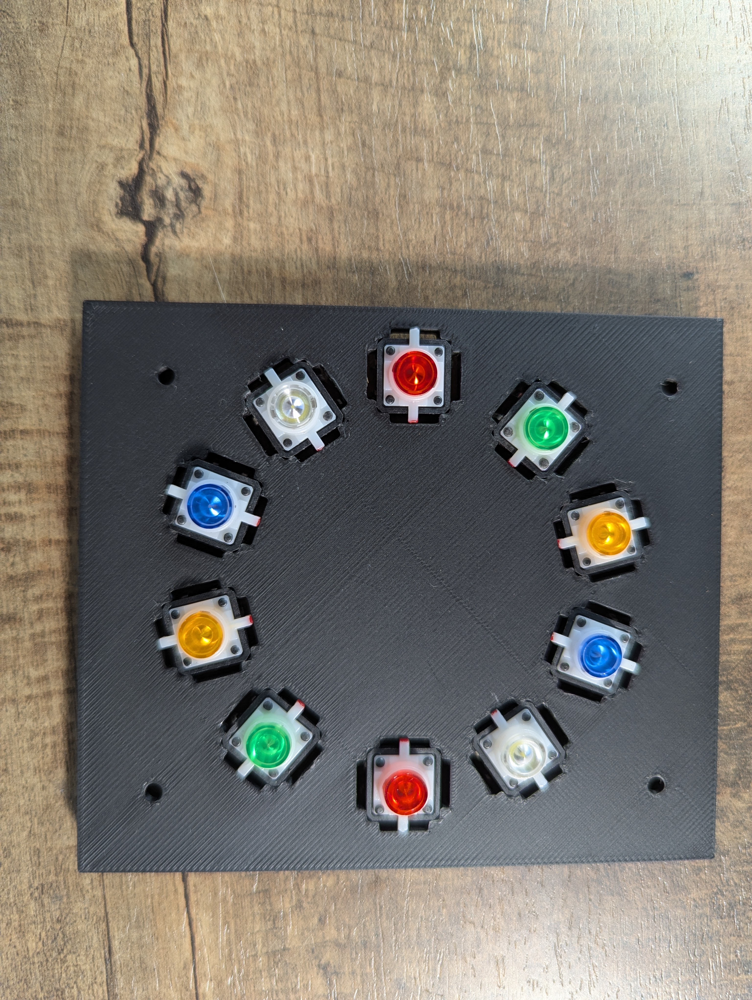 |

You can notice the red mark on the leg of the LEDs. <br>
The red mark indicates the ground side of the LED. <br>
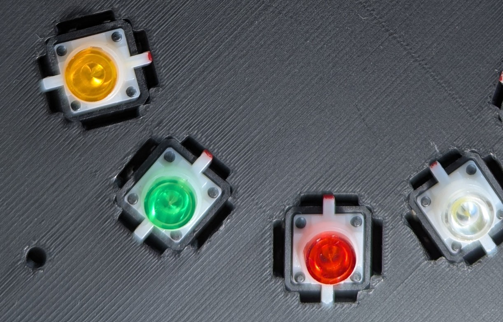

---

## Ground Wiring Reference

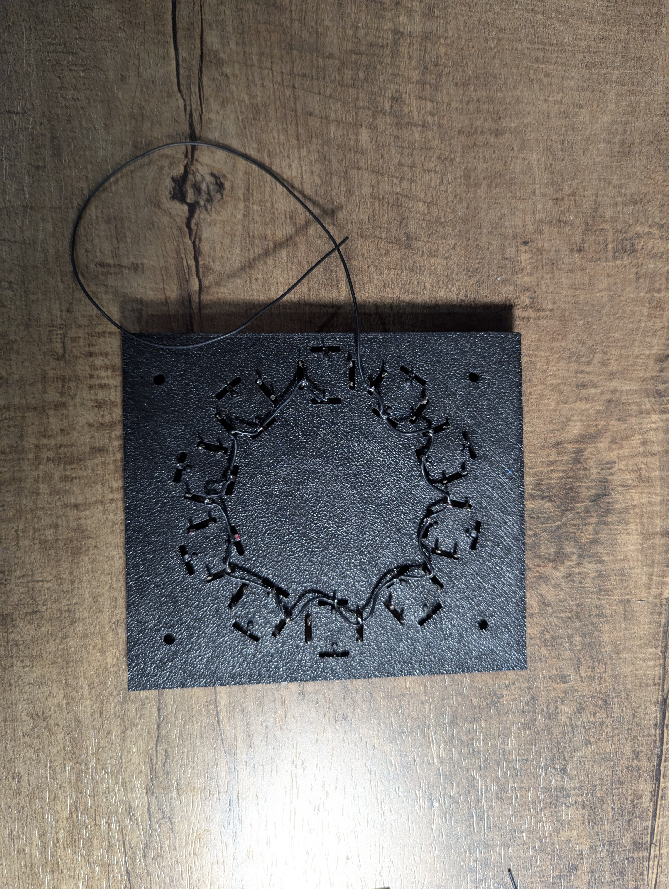 

---

## ESP32 Wiring Reference

| GPIO Wiring | Placement |
|-------------|-------------------|
| 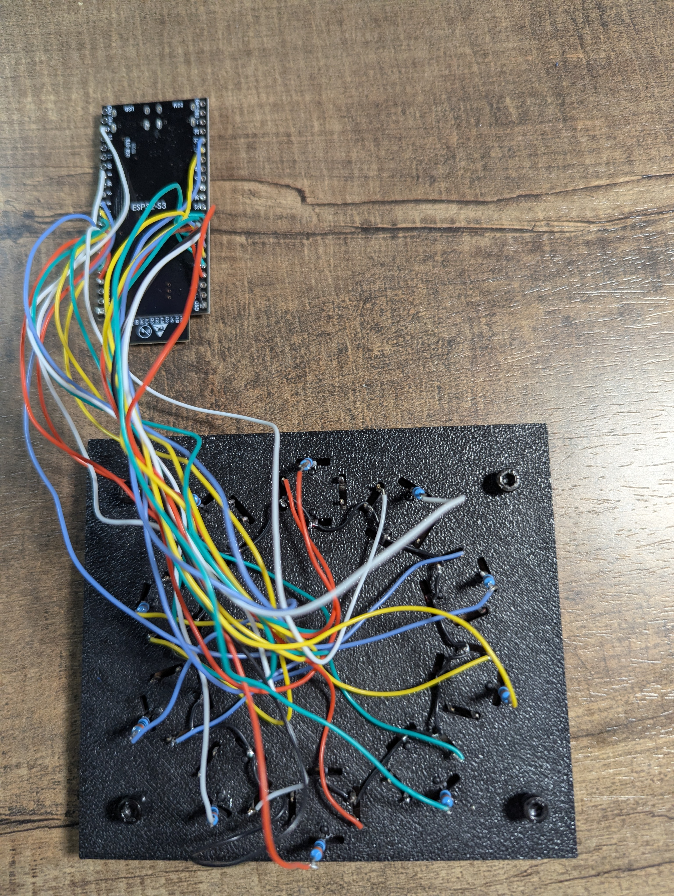 | 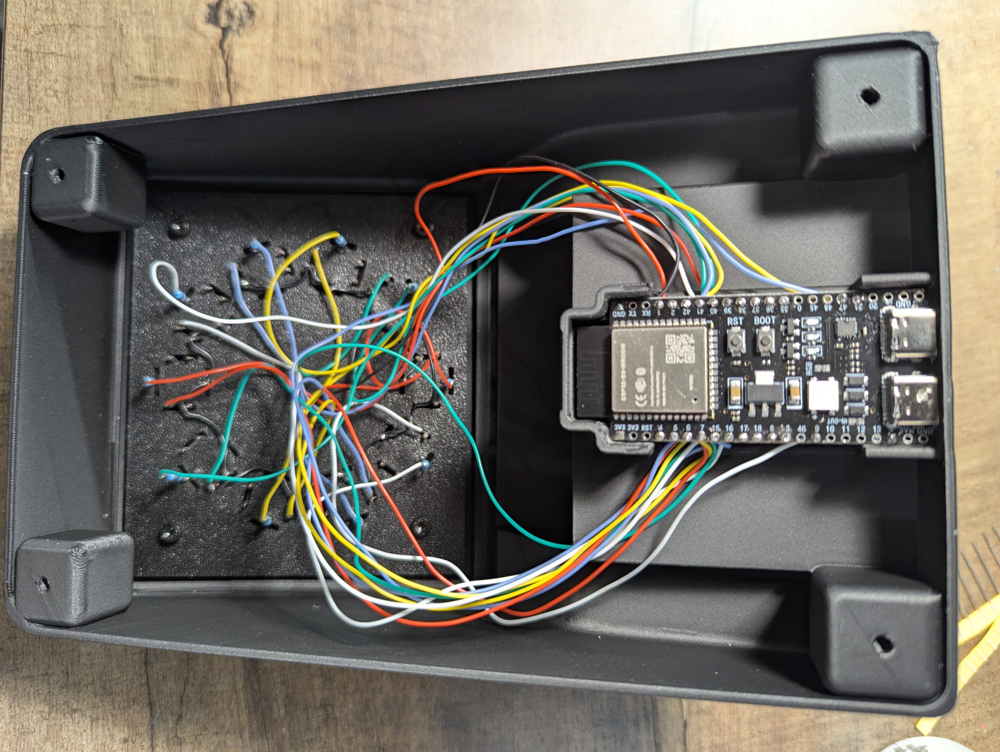 |

---

## Wiring Reference

| GPIO Wiring | Connection Diagram |
|-------------|-------------------|
| 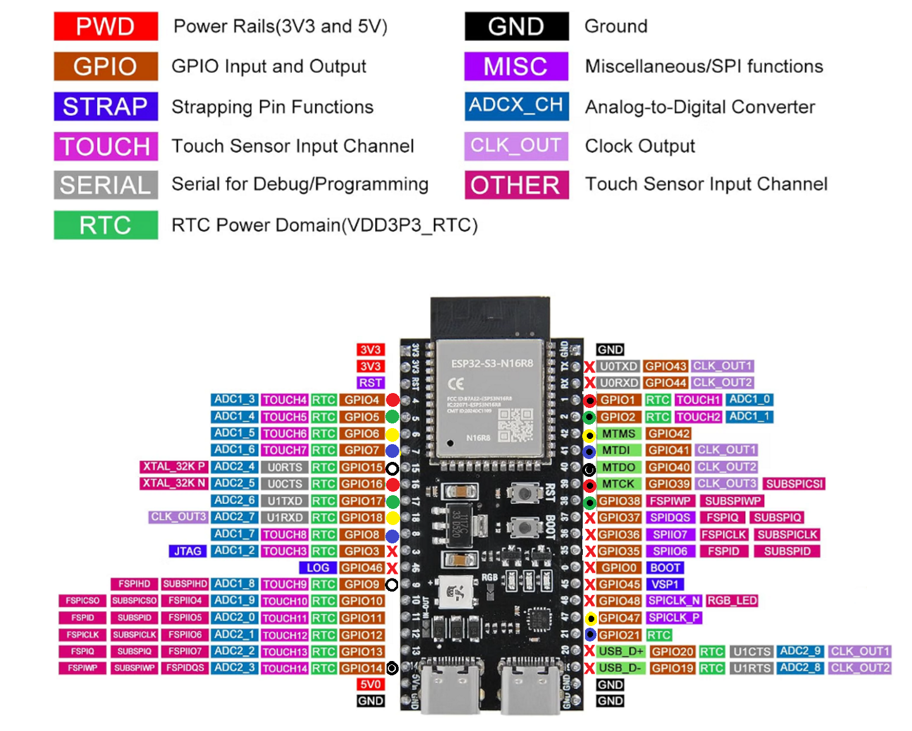 | 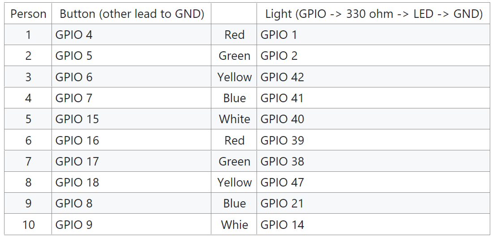 |

---


## Internal Assembly

I used the chart above to add wires to each of the GPIO’s on the ESP32. <br>

Adding 2 sets of 10 wires: <br>
 Button - RED/GREEN/YELLOW/BLUE/WHITE/RED/GREEN/YELLOW/BLUE/WHITE <br>
 LED - RED/GREEN/YELLOW/BLUE/WHITE/RED/GREEN/YELLOW/BLUE/WHITE <br>
 GND - BLACK. <br>

The connection diagram shows a color-coded dot next to the ESP32 locations that I solder wires on to. <br>
I then separated the LED wires and the button wires each on their own side of the <br> enclosure, then closed the ESP32 cover. <br>
I next soldered all the ground (GND) wires to the - on the LEDs <br>
and add a 330 ohm resistor to each LED to reduce the brightness. <br>
I then solder the remaining 20 exposed wires to the correct resistor on the LEDs and the switches. <br>
Match each wire color to the button color for ease and clarity. <br>

When complete, I used 4 M3x10mm Hex head screws to hold the button tray to the phone and then <br>
4 -M3*8 flat head screws to join the bottom and the top together. <br>

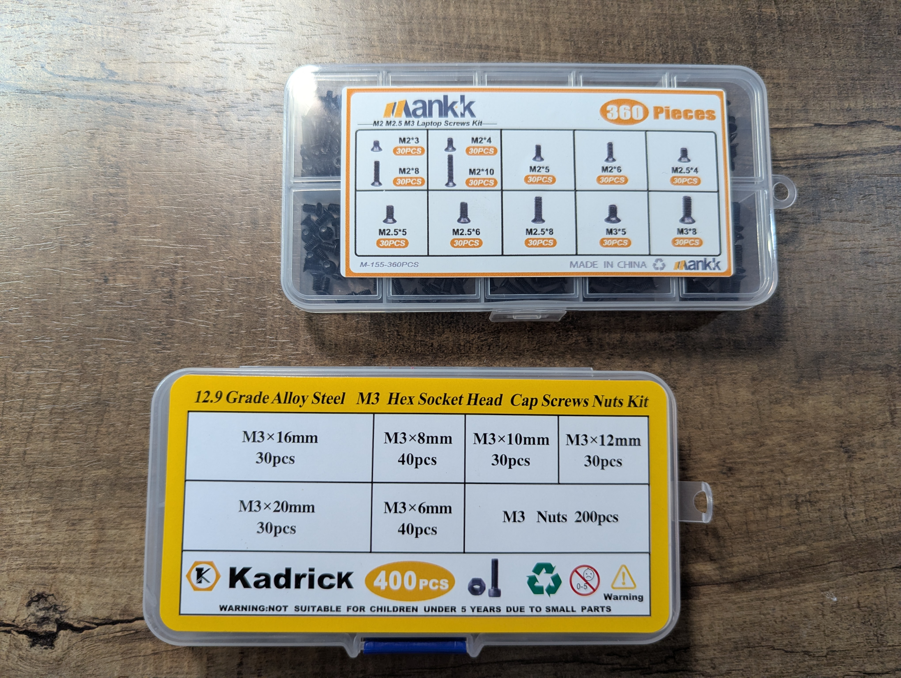

---

# Firmware Installation

Install the Kid Phone firmware using the official installer:

https://allanbinder.github.io/kid-phone/

Follow the instructions provided by the original project documentation.

---

# Device Configuration

After connecting the Kid Phone to WiFi, configuration can be accessed using:

http://kidphone.local/

---

# Bill of Materials

## ESP32-S3 Development Board

Purchase Link: https://www.amazon.com/dp/B0CKXJLP4B

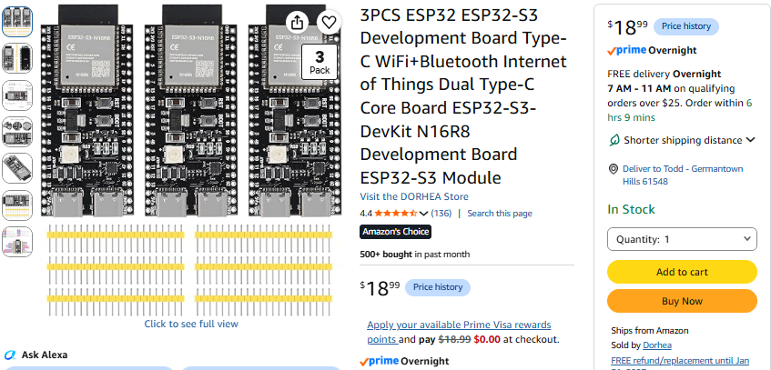)

( You really only need one, but I bought a set of three for other projects)

---

## Handset

Purchase Link:  https://www.amazon.com/dp/B0HKHJDL5S

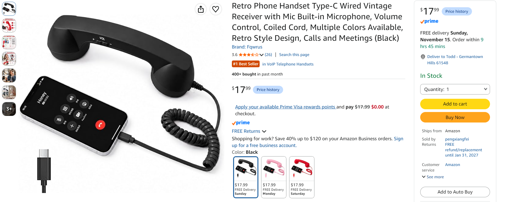 
(This is the link to the handset I ordered, it seems to work well, <br>
though the buttons on the handset are not the same configuration as the Amazon picture shows.) <br>

---


# Printing Notes

- Print all enclosure components using the supplied STL files or better yet, <br>
use the included 3MF file that provides the recommended orientation for a cleaner print. <br>

 ## Print Settings

| Setting | Value |
|----------|----------|
| Printer Model | Bambu Lab X1 Carbon |
| Nozzle Diameter | 0.4 |
| Layer Height | 0.2 |
| Walls | 2 |
| Top Layers | 5 |
| Bottom Layers | 3 |
| Infill Density | 15% |
| Infill Pattern | grid |
| Supports Enabled | 1 |
| Support Type | tree(auto) |
| Support Style | default |
| Support Angle | 30 |
| Objects Found | 4 |
| Plates Used | 3 |

## Plate 1

### rotary-kid-phone.stl

| Property | Value |
|----------|----------|
| Extruder | 1 |
| Face Count |   61926 |
| Orientation | Rotated |
| Rotation X | -60 Deg |
| Rotation Y | 30 Deg |
| Rotation Z | 0 Deg |


## Plate 2

### retroPhoneKid-phone-SPI32Cover.stl

| Property | Value |
|----------|----------|
| Extruder | 1 |
| Face Count |   3322 |
| Orientation | Flat on build plate |
| Rotation X | 0 Deg |
| Rotation Y | 0 Deg |
| Rotation Z | 0 Deg |

### rotary-kid-phone-buttonTray.stl

| Property | Value |
|----------|----------|
| Extruder | 1 |
| Face Count |   18080 |
| Orientation | Flat on build plate |
| Rotation X | 0 Deg |
| Rotation Y | 0 Deg |
| Rotation Z | 0 Deg |


## Plate 3

### retroPhoneKid-phone-Bottom.stl

| Property | Value |
|----------|----------|
| Extruder | 2 |
| Face Count |   21494 |
| Orientation | Flat on build plate |
| Rotation X | 0 Deg |
| Rotation Y | 0 Deg |
| Rotation Z | 0 Deg |

---


# Credits

This enclosure design was created for use for the Kid-Phone project.

Special thanks to:

- Allan Binder
- The Kid Phone project contributors
